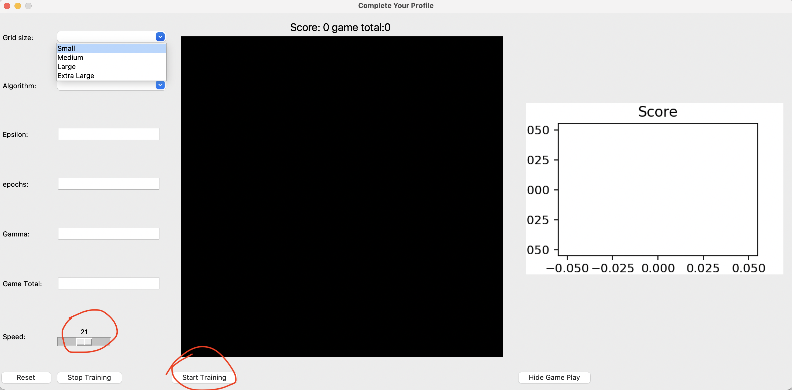
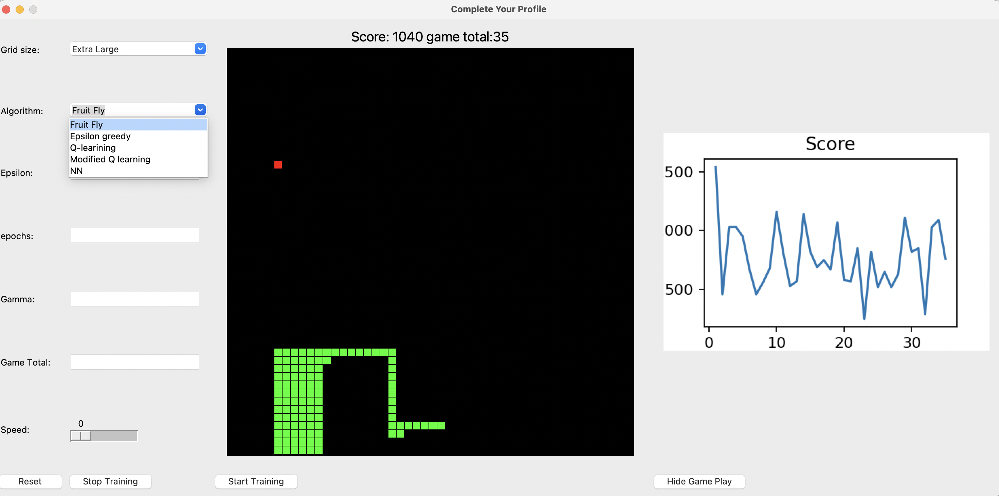

## Project: AI Algorithm Comparison
I am creating a snake bot that uses a GUI control system with drop-down menus to switch up the graphing method of the project. I want to experiment with Q-learning, sarsa, deep q learning, and try to wire the fruit fly connectome  to play snake. 

## Start Demo 
#(algorithm selection button doesn't do anything now) 
Should run 100 rounds of snake. Pressing restart game should reset the snake game so that the speed can be changed. 

---

### 1. `algorithms.py`
Algorithm.py contains the agent object that controls the game. I wanted to set it up so that the agent had access to a bunch of game stats from the main file, and then, I could use inheritance to change the agent function. Ideally, I have the GUI spawn an agent and then pass the agent to the other file. Algotithms.py and problems.py are flipped in functionality right now. Problems.py has the game loop and algorithms has the agent right now. There is a bug where when the apple is above the snake, the snake goes away from the apple before turning around and moving back towards the apple after it is made rational by running into a wall. 

### 2. `comparisons.py`  
I splurged and made a GUI, so comparisons.py functionality will be handled through the gui.

### 3. `demo.py`  
This file stores the GUI of my snake game. Pressing start training starts training. It also resets training right now. Still has some things that need adjusting, but these are quick fixes that will be separate from the main project. The biggest hurdle was setting up the GUI and embedding the graph. There is one bug that causes parts of the snake to not get animated during parts of the game, but it does not effect the physics of the game. 

### 4. `problems.py`  
This file currently has my game loop in it. My game loop is a nightmare. I initially coded it in pygame before realizing I couldn't embed pygame into tkinter because pygame and tkinter both wanted to hog the main OS thread; without multithreading, the pygame loop stops tkinter from refreshing. I spent a day converting the loop to run in tkinter. However, tkinter is a bottleneck and loops slowly. I plan on converting the loops to python and having a function that animates the states of the array for me. 

This file will contain the implementation of the problems you are solving with your AI algorithms.  
- Ensure that the problems are clearly defined and modular, so the algorithms can be easily tested on each.  
- For the **progress report**, this file should be fully implemented and require no major edits afterward.

---
